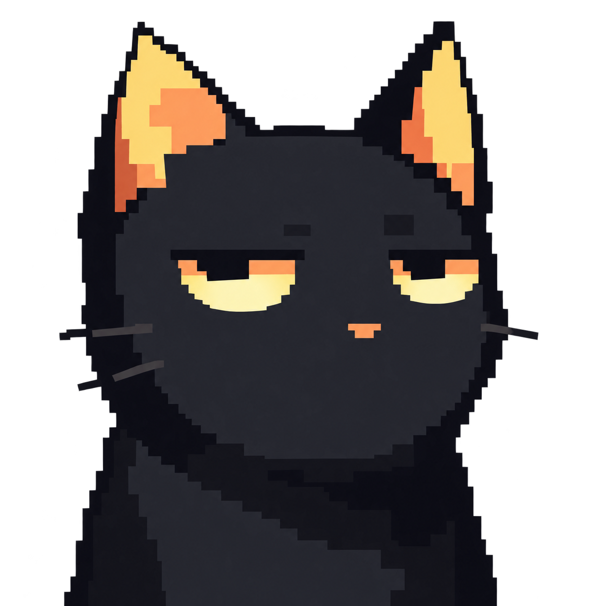
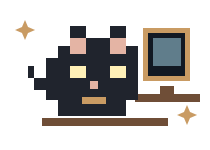

  
  <h1>ARIELLYA PUTRI SAYOW</h1>
  
<code>UI/UX · FRONTEND</code>

  
Designing clear interfaces, building useful ideas, and exploring interactive experiences.

---

## ◉ About Me

<table>
  <tr>
    <td width="150" align="center" valign="top"></td>
    <td valign="top">
      <strong>Hi, I’m Ariellya 👋</strong>  
      I’m an Informatics student interested in UI/UX and frontend development. I enjoy combining design, technology, and visual storytelling to create experiences that are clear, useful, and enjoyable to use.  
      <em>Make it clear, make it useful, then make it memorable.</em>
    </td>
    <td width="145" align="center" valign="top"></td>
  </tr>
</table>

---

## ◉ What I’m Exploring

<table>
  <tr>
    <td valign="top">
      <ul>
        <li>UI/UX design and user research</li>
        <li>Frontend and web development</li>
        <li>Interactive games and digital media</li>
        <li>Drawing and visual design</li>
      </ul>
    </td>
    <td width="185" align="center" valign="middle">
       
      my tiny coding companion
    </td>
  </tr>
</table>

---

## ◉ Featured Projects

<table>
  <tr>
    <td width="50%" valign="top">
      <strong><a href="https://github.com/ariellyasayow/benteng-forge">Benteng Forge</a></strong> 
      A visual map editor for Bentengan Squad Tag — craft arenas, place props, and shape gameplay.
    </td>
    <td width="50%" valign="top">
      <strong><a href="https://github.com/ariellyasayow/Survivor-Arena">Survivor Arena</a></strong> · <a href="https://survivor-arena-nu.vercel.app">Live demo</a> 
      An interactive browser game built with JavaScript.
    </td>
  </tr>
  <tr>
    <td width="50%" valign="top">
      <strong><a href="https://github.com/ariellyasayow/Portofolio-Web">Portfolio Web</a></strong> · <a href="https://portofolio-web-seven-drab.vercel.app">Live demo</a> 
      My personal portfolio website, showcasing design and frontend work.
    </td>
    <td width="50%" valign="top">
      <strong><a href="https://github.com/ariellyasayow/Klinik-Sentosa">Klinik Sentosa</a></strong> 
      A clinic management interface built with TypeScript.
    </td>
  </tr>
</table>

  More on <a href="https://github.com/ariellyasayow?tab=repositories">my repositories</a> and <a href="https://ariellya.vercel.app/">my portfolio</a>.

---

## ◉ Tools & Technologies

   
  
    

---

## ◉ GitHub Activity

  
  

---

## ◉ Let’s Connect

  
    
  
  
  

